Я відкрив термінал у Kali та перевірив доступні команди інструменту Amass за допомогою amass -h і запустив процес активного збору піддоменів для сайту amass enum -d softserveinc.com

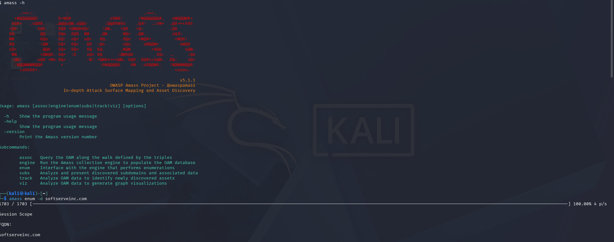

Використав команду amass enum -passive -d softserveinc.com для пасивного осінту

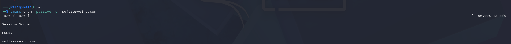

Використав amass track -d softserveinc.com, щоб вивести з бази даних Amass повний список усіх раніше знайдених піддоменів компанії

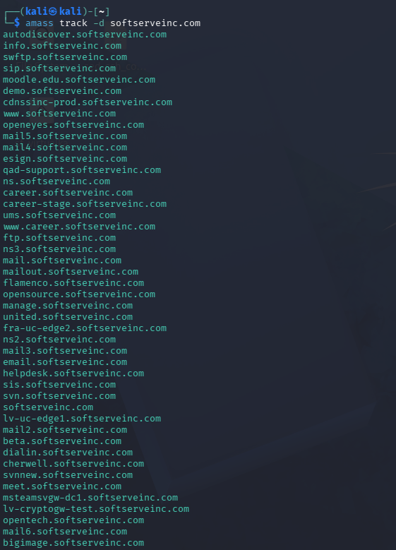

Запустив сканування акаунта softserve командою sherlock softserve --print-all, і програма почала послідовно перевіряти наявність цього імені користувача на різних вебплатформах

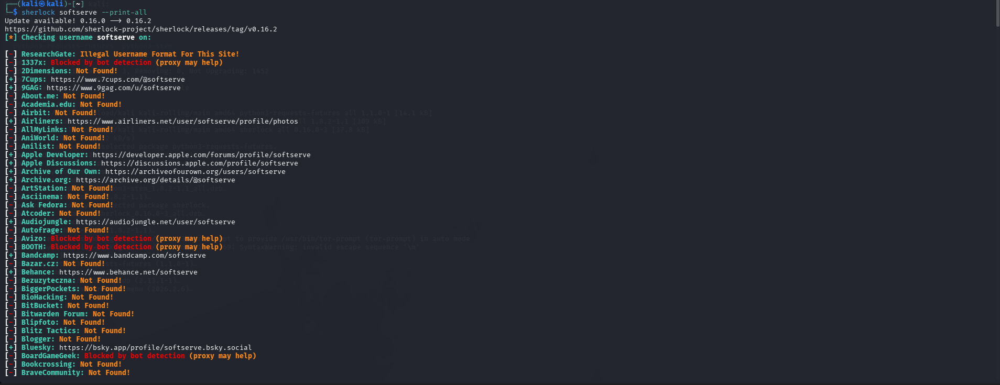

Запустив пошук облікового запису softserve за допомогою утиліти Sherlock, додавши прапорець -o ~/result.txt, щоб відразу зберегти всі результати у текстовий файл

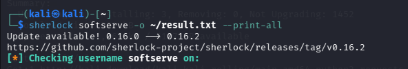

Запустив Sherlock із параметром --csv, щоб зберегти отримані результати пошуку у форматі CSV-таблиці.

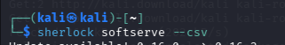

Використав команду ls -l і перевірив список файлів у директорії, переконавшись, що файли result.txt, softserve.csv та softserve.txt успішно створилися

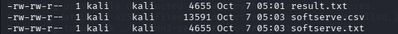

Я відкрив збережений файл результатів за допомогою команди cat result.txt і вивів у термінал повний список знайдених посилань на облікові записи

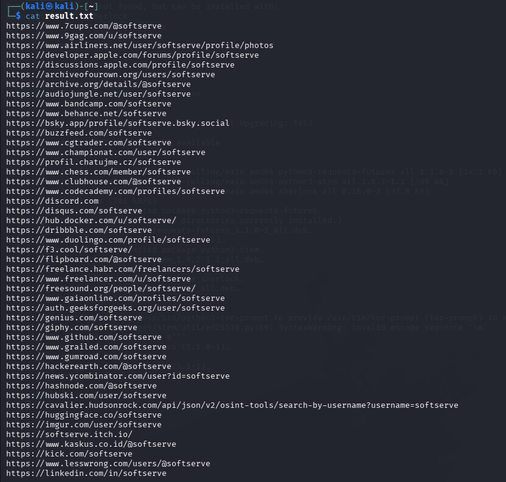

Відправив два ICMP-запити командою ping -c 2 softserveinc.com і дізнався IP-адресу цілі — 45.60.63.61

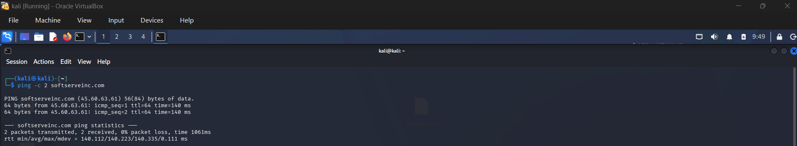

Використав Shodan для перевірки відкритих портів за IP-адресою командою shodan stats --facets port net:45.60.63.61

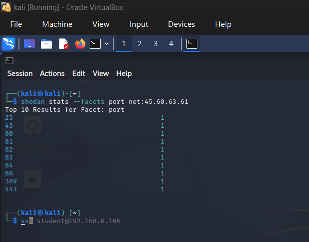

Запросив статистику відкритих портів для всієї підмережі 45.60.63.61/24 та отримав 10 найпопулярніших портів у цій мережі

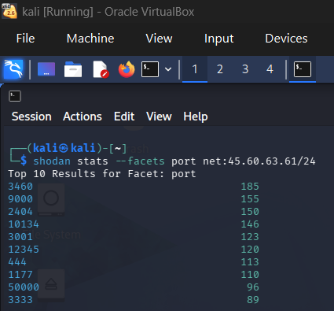

